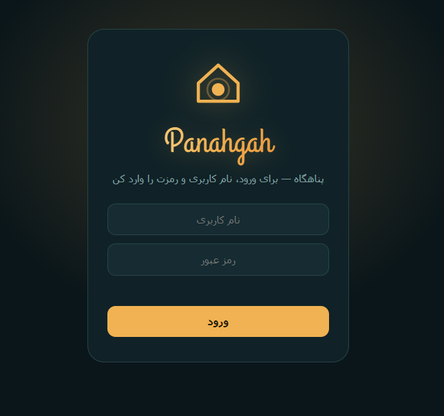
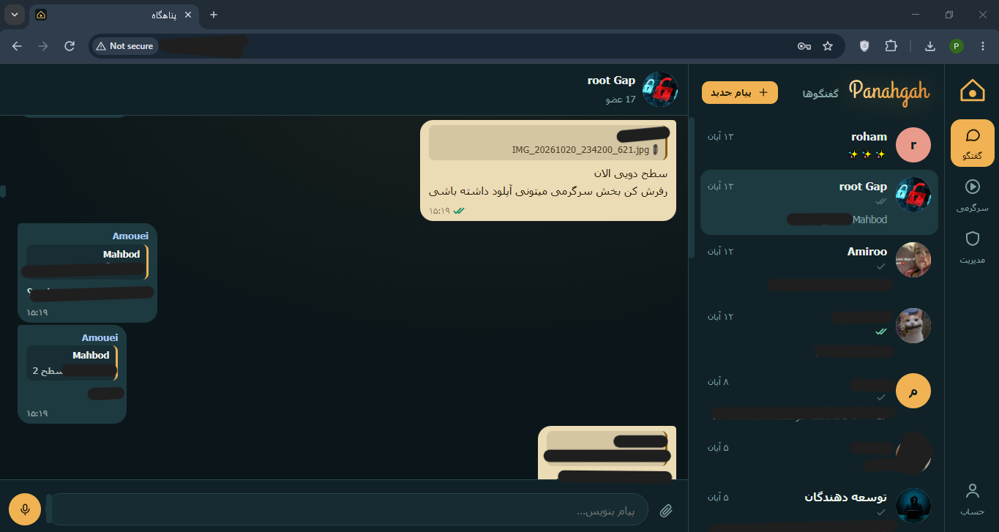
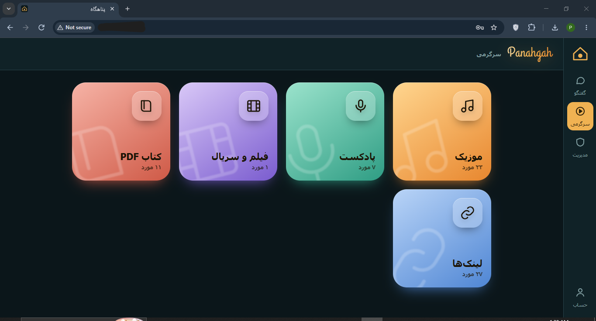
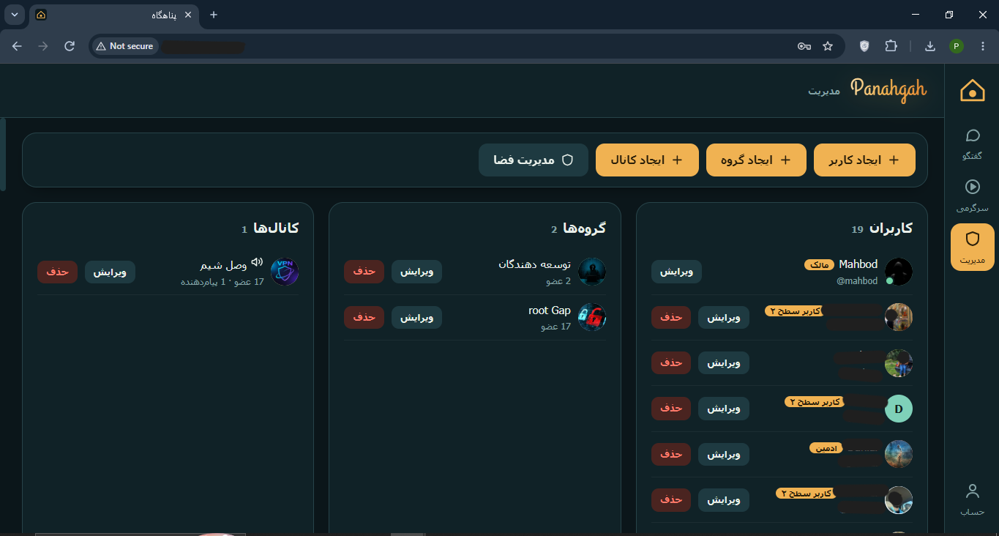

<div dir="rtl" align="right">

<div align="center">

# 🏠 پناهگاه · Panahgah

### پیام‌رسان خودتان؛ حتی وقتی اینترنت نیست

یک پیام‌رسان فارسی سبک و خودمیزبان برای خودتان و آدم‌های خودتان.<br>
یک سرور، یک دستور، بدون هیچ وابستگی خارجی.


[English](README.md) · [شروع سریع](#-شروع-سریع) · [نصب آفلاین](#-نصب-آفلاین-بدون-اینترنت) · [امکانات](#-امکانات) · [مدیریت](#️-مدیریت)

</div>

---

## 💡 چرا پناهگاه؟

وقتی اینترنت بین‌الملل قطع می‌شود، برنامه‌هایی که به آن‌ها عادت کرده‌ایم هم از دسترس خارج می‌شوند. پناهگاه جواب یک سؤال ساده است: **اگر گروه شما پیام‌رسان اختصاصی خودش را روی سرور خودش داشت، و تا وقتی شبکه‌ی داخلی کار می‌کند او هم کار می‌کرد، چه؟**

روی سرور نصبش می‌کنید، کاربر می‌سازید و نام کاربری و رمز را به دوستانتان می‌دهید. همین. بدون CDN، بدون فونت آنلاین، بدون سرویس شخصِ ثالث، بدون صفحه‌ی ثبت‌نام و بدون شماره‌ی تلفن. هر چه برنامه لازم دارد همراهش است.

برای قطعی نت ملی ساخته شده، ولی برای هر کس که پیام‌رسان خصوصی برای دوستان، خانواده یا یک تیم کوچک می‌خواهد هم عالی است.

## 📸 نگاهی به برنامه

<table>
  <tr>
    <td align="center"><b>ورود</b><br></td>
    <td align="center"><b>گفت‌وگوی گروهی</b><br></td>
  </tr>
  <tr>
    <td align="center"><b>سرگرمی</b><br></td>
    <td align="center"><b>پنل مدیریت</b><br></td>
  </tr>
</table>

## ✨ امکانات

| | |
|---|---|
| 💬 **گفتگو** | پیام خصوصی، گروه و کانال (فقط افراد مجاز می‌نویسند)، ریپلای، حذف پیام، تگ کردن با `@`، سین پیام (✓ / ✓✓) |
| 📎 **فایل و ویس** | ارسال فایل و عکس (انتخاب، کشیدن و رها کردن، paste) و ضبط و ارسال ویس |
| 🎬 **سرگرمی** | موزیک، پادکست، فیلم و سریال، کتاب PDF با پخش درون‌برنامه، و لیست لینک‌هایی که روی نت ملی باز می‌شوند |
| 🛡️ **سطح دسترسی** | مالک، ادمین، کاربر سطح ۲ (آپلودکننده)، کاربر عادی |
| 💾 **مدیریت فضا** | محافظ‌های خودکار دیسک، سهمیه‌ی کاربران، پاک‌سازی اضطراری، داشبورد مالک |
| 📱 **PWA** | روی صفحه‌ی اصلی گوشی نصب می‌شود و شبیه یک برنامه‌ی واقعی است |
| 🌐 **فارسی، راست‌به‌چپ، موبایل‌محور** | از ابتدا برای گوشی طراحی شده |
| 🪶 **پشته‌ی سبک** | Python + Flask، دیتابیس SQLite، فرانت‌اند در یک فایل HTML. بدون build و بدون نیاز به Docker |

## 🚀 شروع سریع

**پیش‌نیاز:** سرور **Ubuntu 22.04 یا 24.04**، دسترسی root و Python 3.10 به بالا. یک هسته و ۱ گیگ رم برای یک گروه کوچک کافی است.

روی سرور، با کاربر root:

```bash
bash <(curl -fsSL https://raw.githubusercontent.com/MahbodA/panahgah/main/install.sh)
```

نصب‌کننده نام کاربری، رمز و نام نمایشی مالک را می‌پرسد، همه‌چیز را در `/opt/panahgah` نصب می‌کند و سرویس systemd را روی **پورت ۸۰۰۱** بالا می‌آورد (به nginx و پورت ۸۰ دست نمی‌زند). بعد این آدرس را باز کنید:

```
http://IP_SERVER:8001
```

<details>
<summary><b>نصب بدون سؤال، به‌روزرسانی و گزینه‌ها</b></summary>

```bash
OWNER_USER=admin OWNER_PASS='رمز-قوی' OWNER_NAME='نام من' PORT=8001 \
  bash <(curl -fsSL https://raw.githubusercontent.com/MahbodA/panahgah/main/install.sh)
```

- **به‌روزرسانی:** همان دستور را دوباره اجرا کنید. کد به‌روز می‌شود و همه‌ی اطلاعات (کاربران، پیام‌ها، فایل‌ها) می‌ماند.
- **PyPI در دسترس نیست؟** نصب‌کننده خودکار سراغ میرور داخلی می‌رود. با `PIP_INDEX_URL=...` هم می‌توانید میرور دلخواه بدهید.
- **پورت دیگر:** `PORT=8002`.

</details>

> ⚠️ **این روش را قبل از قطعی انجام دهید.** نصب آنلاین به GitHub، PyPI و apt نیاز دارد. اگر اینترنت بین‌الملل از قبل قطع است، از کیت آفلاین پایین استفاده کنید.

## 📦 نصب آفلاین (بدون اینترنت)

همه‌ی نیازمندی‌های سرور، از جمله تمام کتابخانه‌های پایتون، در پوشه‌ی [`offline/`](offline) است. **هیچ چیزی دانلود نمی‌شود**: نه apt، نه pip، نه GitHub. یک نسخه از این دو فایل را **همین حالا** جای امنی نگه دارید تا وقتی لازم شد دستتان باشد.

1. فایل‌های `offline/panahgah-offline.zip` و `offline/install.sh` را بردارید.
2. هر دو را به پوشه‌ی `/opt` سرور بفرستید:
   ```bash
   scp panahgah-offline.zip install.sh root@IP_SERVER:/opt/
   ```
3. نصب‌کننده را اجرا کنید:
   ```bash
   ssh root@IP_SERVER
   cd /opt && bash install.sh
   ```
4. ورودی‌ها (نام کاربری، رمز و نام نمایشی مالک) را بدهید. تمام: `http://IP_SERVER:8001`

متغیرهای اختیاری اینجا هم کار می‌کنند: `PORT=8002`، `OWNER_USER=... OWNER_PASS=...` و `PANAHGAH_DIR=...`. اجرای دوباره با zip جدیدتر، کد را به‌روز می‌کند و داده‌ها را نگه می‌دارد.

## 🛠️ مدیریت

بعد از نصب، دستور `panahgah-manage` در دسترس است:

```bash
panahgah-manage list                                   # لیست کاربران
panahgah-manage user     NAME PASSWORD "نام نمایشی"    # کاربر عادی
panahgah-manage uploader NAME PASSWORD "نام نمایشی"    # سطح ۲ (آپلود در سرگرمی)
panahgah-manage admin    NAME PASSWORD "نام نمایشی"    # ادمین
panahgah-manage passwd   NAME NEWPASSWORD              # تغییر رمز
panahgah-manage faststart                              # شروع سریع‌تر پخش mp4/m4a قدیمی
```

بیشتر کارهای روزمره (ساخت کاربر، گروه و کانال، مدیریت فضا) از بخش **«مدیریت»** خود برنامه و با حساب مالک انجام می‌شود.

| نقش | دسترسی |
|---|---|
| **مالک** | همه‌چیز: کاربران، ادمین‌ها، گروه‌ها، کانال‌ها، فضا، هر محتوا |
| **ادمین** | حذف پیام، افزودن و ویرایش کاربر عادی و سطح ۲، مدیریت محتوای سرگرمی |
| **سطح ۲** | امکانات کاربر عادی + آپلود محتوا و افزودن لینک در سرگرمی |
| **کاربر عادی** | پیام، فایل، ویس، ریپلای و حذف پیام‌های خودش |

```bash
systemctl status panahgah      # روشن است؟
journalctl -u panahgah -f      # لاگ زنده
systemctl restart panahgah
```

<details>
<summary><b>⚙️ تنظیمات</b></summary>

در فایل `/etc/systemd/system/panahgah.service` تنظیم می‌شوند. بعدش: `systemctl daemon-reload && systemctl restart panahgah`

| متغیر | پیش‌فرض | توضیح |
|---|---|---|
| `OWNER_USERNAME` | توسط نصب‌کننده | نام کاربری که دسترسی مالک دارد |
| `MAX_UPLOAD_MB` | `3072` | سقف سخت حجم هر درخواست |
| `MIN_FREE_GB` | `4` | زیر این مقدار فضای آزاد، آپلود بسته می‌شود |
| `HTTPS` | `0` | فقط وقتی سایت واقعاً با HTTPS باز می‌شود `1` بگذارید (کوکی امن) |
| `PANAHGAH_DATA` | `<app>/data` | مسیر دیتابیس و فایل‌های آپلودی |
| `ACCEL_REDIRECT` | `0` | با `1` فایل‌ها را nginx سرو می‌کند (بخش ۱۹ در `docs/DEPLOY.fa.txt`) |

</details>

<details>
<summary><b>🎙️ HTTPS و ضبط ویس</b></summary>

مرورگرها ضبط مستقیم میکروفون را فقط روی HTTPS اجازه می‌دهند. روی HTTP ساده، دکمه‌ی ویس برنامه‌ی ضبط خود گوشی را باز می‌کند که آن هم خوب کار می‌کند. برای ضبط مستقیم داخل برنامه، nginx یا Caddy با گواهی جلوی برنامه بگذارید (برای سرور بدون دامنه، گواهی خودامضا کافی است) و `HTTPS=1` را تنظیم کنید. جزئیات: [`docs/DEPLOY.fa.txt`](docs/DEPLOY.fa.txt)، بخش ۱۳.

</details>

<details>
<summary><b>🗄️ بکاپ و بازیابی</b></summary>

همه‌ی داده‌ها در `/opt/panahgah/data` است (دیتابیس، فایل‌ها، کلید نشست).

```bash
systemctl stop panahgah
tar czf /root/panahgah-backup-$(date +%F).tar.gz -C /opt/panahgah data
systemctl start panahgah
```

بازیابی: سرویس را متوقف کنید، آرشیو را در `/opt/panahgah` باز کنید، `chown -R panahgah:panahgah /opt/panahgah/data` بزنید و سرویس را روشن کنید.

</details>

## 🗂️ ساختار ریپازیتوری

```
install.sh                      نصب‌کننده‌ی آنلاین (one-click)
app/                            خود برنامه (منبع اصلی کد)
  app.py  manage.py  requirements.txt  static/
offline/
  install.sh                    نصب‌کننده‌ی آفلاین
  panahgah-offline.zip          برنامه + همه‌ی کتابخانه‌های پایتون
tools/
  build-offline.sh              ساخت دوباره‌ی zip آفلاین از روی app/
docs/
  DEPLOY.fa.txt                 راهنمای دپلوی (فارسی)
  Maintenance_Handbook.fa.pdf   کتابچه‌ی کامل نگهداری (فارسی)
```

چیزی در `app/` را عوض کردید؟ روی یک سیستم با اینترنت (ترجیحاً Ubuntu 24.04) کیت آفلاین را دوباره بسازید:

```bash
bash tools/build-offline.sh
```

## 🔒 نکات امنیتی

- پیام‌ها **رمزنگاری سرتاسری ندارند**. مدیر سرور به دیتابیس دسترسی دارد، پس فقط افراد مورد اعتماد را عضو کنید.
- به‌صورت پیش‌فرض سایت روی HTTP ساده و یک پورت بالا می‌آید. اگر می‌توانید HTTPS راه بیندازید و حتماً رمزهای قوی بگذارید.
- ثبت‌نام آزاد وجود ندارد؛ فقط مالک و ادمین‌ها کاربر می‌سازند.
- فایل `data/secret.key` را جایی منتشر نکنید و از پوشه‌ی `data/` بکاپ بگیرید.

## 📄 مجوز

[MIT](LICENSE). فونت لوگو (Grand Hotel) تحت مجوز SIL Open Font License است.

---

<div align="center">

ساخته‌شده با ❤️ توسط **Mahbod.A** · اگر پناهگاه به کارتان آمد، یک ⭐ روی ریپو خیلی ارزشمند است.

</div>

</div>
