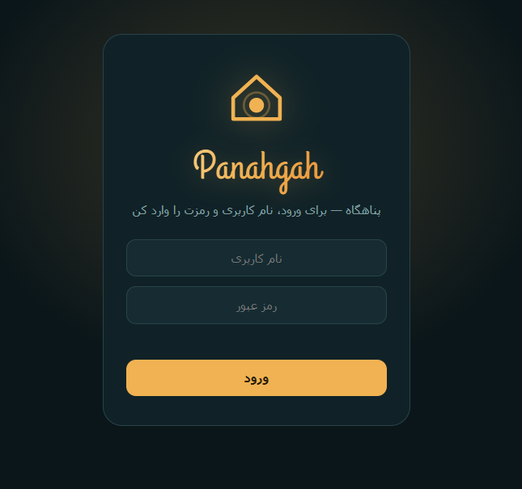
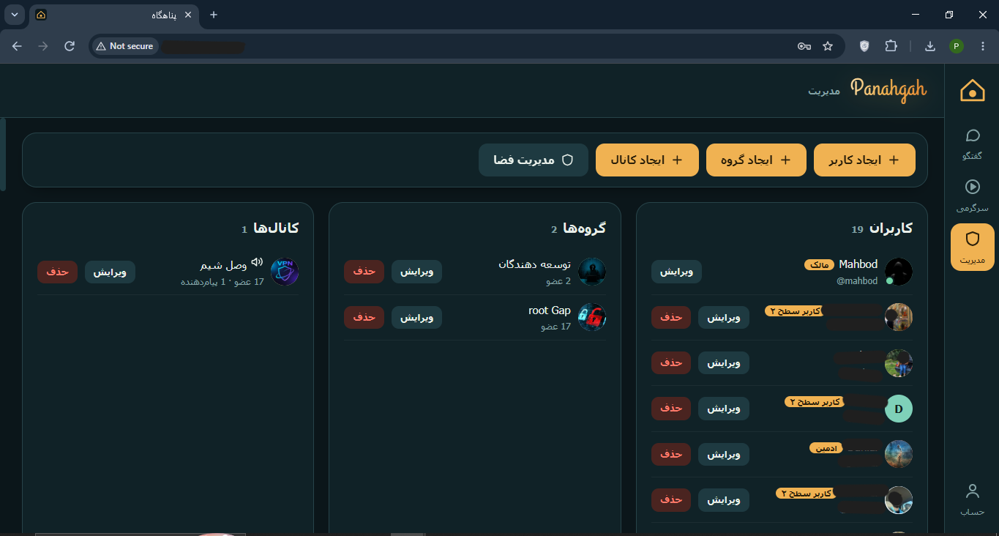
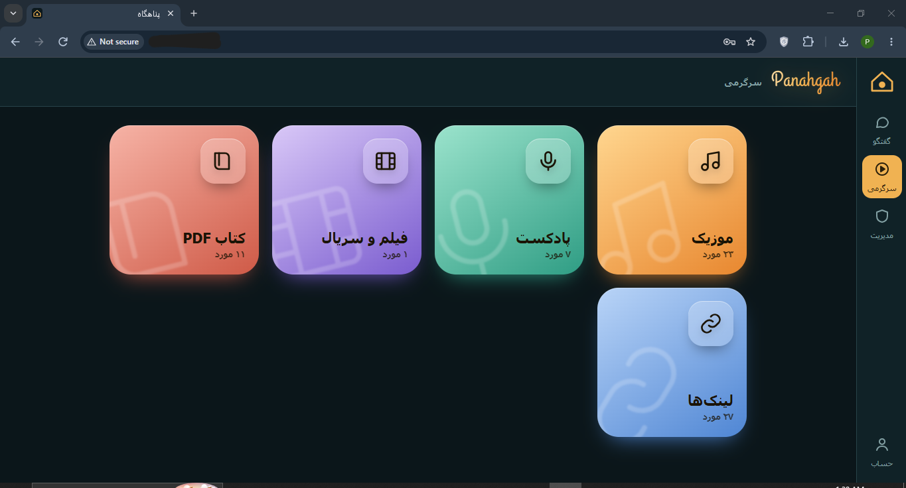
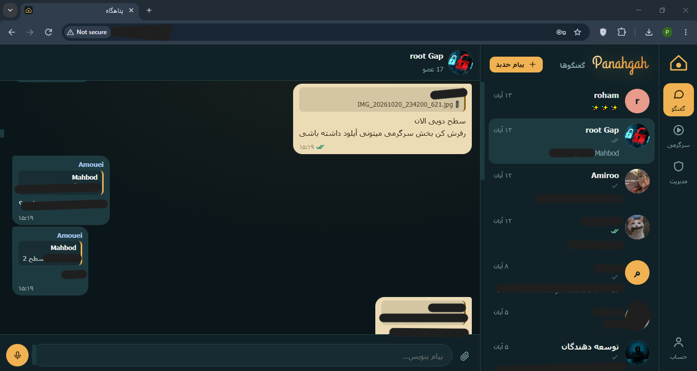

<div align="center">

# Panahgah · پناهگاه

**A tiny self-hosted Persian messenger for you and your friends — built to keep working when the international internet doesn't.**

[فارسی](README.fa.md) · [Features](#features) · [Install](#install) · [Offline install](#offline-install-no-internet) · [Administration](#administration)

</div>

---

Panahgah runs on a single cheap VPS (or any Ubuntu box on a domestic network), with **no external dependencies at runtime**: no CDN, no online fonts, no third-party services. You create accounts, hand out usernames and passwords, and your group has its own private messenger, even during an internet shutdown, as long as the server is reachable on the local/national network.

It is not tied to any country, though: anyone who wants their own messenger for friends, family or a small team can use it.

## Features

- **Chats**: private messages, groups and read-only/announcement channels, replies, message deletion, `@mentions` in groups, read receipts (✓ / ✓✓)
- **Files and voice**: attachments, images (drag-and-drop or paste), voice messages
- **Entertainment section**: music, podcasts, movies & series, PDF books with in-app playback, plus a shared list of links that open on the domestic network
- **Roles**: owner, admin, level-2 uploader, regular user
- **Storage management**: disk guards, per-user quotas, automatic emergency clean-up, owner dashboard
- **PWA**: install to the phone's home screen
- **Persian / RTL UI**, mobile-first
- **Tiny stack**: Python + Flask, SQLite, one HTML file for the frontend, no build step

## Requirements

- A server running **Ubuntu 22.04 / 24.04** (other Debian-based systems should work but are untested), root access, Python 3.10+
- 1 vCPU / 1 GB RAM is enough for a small group

## Install

On the server, as root:

```bash
bash <(curl -fsSL https://raw.githubusercontent.com/MahbodA/panahgah/main/install.sh)
```

The script asks for the owner's username, password and display name, installs everything under `/opt/panahgah`, and starts a systemd service on **port 8001** (it does not touch nginx or port 80). Open `http://SERVER_IP:8001` and sign in.

Non-interactive:

```bash
OWNER_USER=admin OWNER_PASS='a-strong-password' OWNER_NAME='My Name' PORT=8001 \
  bash <(curl -fsSL https://raw.githubusercontent.com/MahbodA/panahgah/main/install.sh)
```

Re-running the same command **updates** the code and keeps all data (users, messages, files). If PyPI is unreachable, the installer falls back to a domestic mirror; you can also pass `PIP_INDEX_URL=...`.

> Do this **before** an outage. The online installer needs GitHub, PyPI and apt. If the international internet is already down, use the offline kit below.

## Offline install (no internet)

Everything the server needs (all Python libraries included) is in [`offline/`](offline). Nothing is downloaded: no apt, no pip, no GitHub.

1. Download `offline/panahgah-offline.zip` and `offline/install.sh` (keep a copy somewhere safe **now**).
2. Copy both to the server's `/opt`:
   ```bash
   scp panahgah-offline.zip install.sh root@SERVER_IP:/opt/
   ```
3. Run:
   ```bash
   ssh root@SERVER_IP
   cd /opt && bash install.sh
   ```
4. Answer the prompts (owner username / password / display name). Done: `http://SERVER_IP:8001`.

Same optional variables work: `PORT=8002`, `OWNER_USER=... OWNER_PASS=...`, `PANAHGAH_DIR=...`. Re-running with a newer zip updates the code and keeps the data.

## Administration

After installation the `panahgah-manage` command is available:

```bash
panahgah-manage list                            # list users
panahgah-manage user     NAME PASSWORD "Display name"   # regular user
panahgah-manage uploader NAME PASSWORD "Display name"   # level-2 (can upload entertainment content)
panahgah-manage admin    NAME PASSWORD "Display name"   # admin
panahgah-manage passwd   NAME NEWPASSWORD       # reset a password
panahgah-manage faststart                       # make old mp4/m4a files start playing faster
```

Most day-to-day work (creating users, groups, channels, managing storage) is done from the **Manage** panel in the web UI, signed in as the owner.

| Role | Can do |
|---|---|
| **Owner** | Everything: users, admins, groups, channels, storage, any content |
| **Admin** | Delete messages, add/edit regular and level-2 users, manage entertainment content |
| **Level 2** | Regular features + upload entertainment content and add links |
| **User** | Messages, files, voice, replies, delete own messages |

Service control:

```bash
systemctl status panahgah
journalctl -u panahgah -f
systemctl restart panahgah
```

### Configuration

Set in `/etc/systemd/system/panahgah.service` (then `systemctl daemon-reload && systemctl restart panahgah`):

| Variable | Default | Meaning |
|---|---|---|
| `OWNER_USERNAME` | set by installer | Username that has owner rights |
| `MAX_UPLOAD_MB` | `3072` | Hard limit for one request |
| `MIN_FREE_GB` | `4` | Uploads are refused below this much free disk |
| `HTTPS` | `0` | Set to `1` only when the site is really served over HTTPS (secure cookies) |
| `PANAHGAH_DATA` | `<app>/data` | Where the database and uploads live |
| `ACCEL_REDIRECT` | `0` | `1` lets nginx serve uploaded files (see `docs/DEPLOY.fa.txt`, section 19) |

### HTTPS and voice recording

Browsers only allow direct microphone recording on HTTPS. Over plain HTTP the voice button opens the phone's own recorder instead, which still works. For direct recording put nginx/Caddy with a certificate in front (a self-signed certificate is fine for IP-only setups) and set `HTTPS=1`. Details: [`docs/DEPLOY.fa.txt`](docs/DEPLOY.fa.txt), section 13.

### Backup and restore

All data lives in `/opt/panahgah/data` (database, uploads, session key).

```bash
systemctl stop panahgah
tar czf /root/panahgah-backup-$(date +%F).tar.gz -C /opt/panahgah data
systemctl start panahgah
```

Restore: stop the service, extract the archive into `/opt/panahgah`, `chown -R panahgah:panahgah /opt/panahgah/data`, start the service.

## Repository layout

```
install.sh                 online one-click installer
app/                       the application (single source of truth)
  app.py  manage.py  requirements.txt  static/
offline/
  install.sh               offline installer
  panahgah-offline.zip     app + all Python libraries
tools/
  build-offline.sh         rebuild the offline zip from app/
docs/
  DEPLOY.fa.txt            detailed deployment notes (Persian)
  Maintenance_Handbook.fa.pdf   full maintenance handbook (Persian)
```

After changing anything in `app/`, rebuild the offline kit on a machine with internet (ideally Ubuntu 24.04):

```bash
bash tools/build-offline.sh
```

## Security notes

- Messages are **not end-to-end encrypted**. The server administrator can read the database. Only add people you trust.
- Out of the box the site is plain HTTP on a port. Use HTTPS if you can, and use strong passwords.
- There is no public sign-up; only the owner/admins create accounts.
- Keep `data/secret.key` private and back up `data/`.

## License

[MIT](LICENSE). The bundled brand font (Grand Hotel) is under the SIL Open Font License.

---

## Screenshots

### Login


### Management


### Hobbies


### Group Chat
